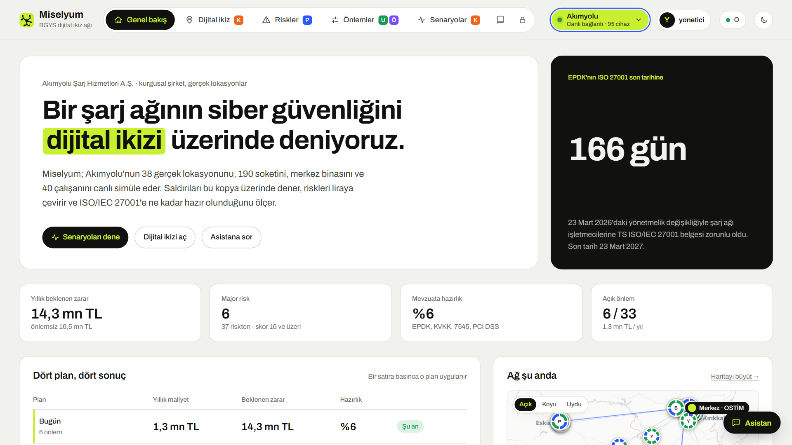
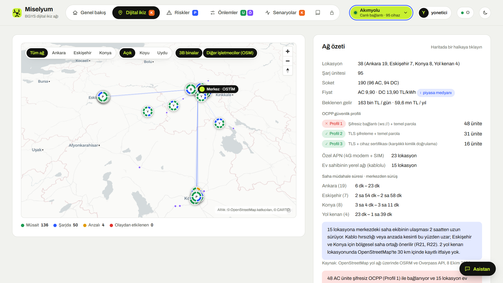
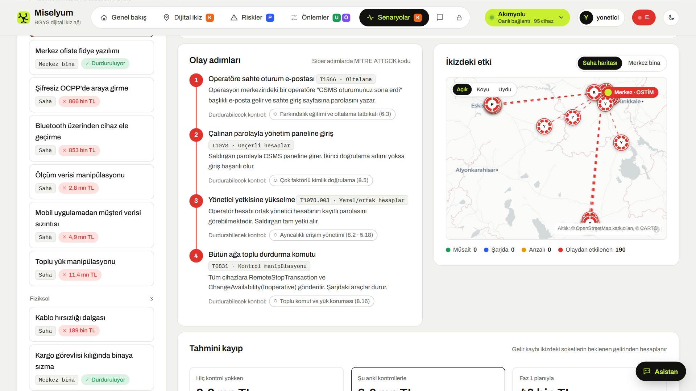
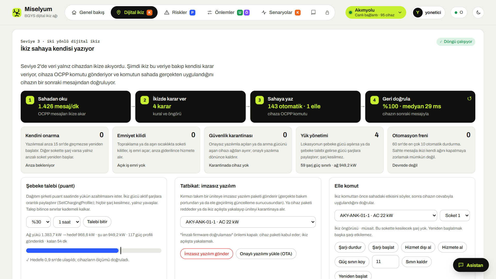

# Miselyum · BGYS dijital ikiz ağı

ISO/IEC 27001 odaklı bilgi güvenliği yönetim sistemi (BGYS) için bir dijital ikiz ağı. Şirketlerin dağınık sistemlerini tek bir risk ağına bağlar: gerçek lokasyonlar ve cihazlar ikizde canlanır, riskler liraya çevrilir, önlemler ve olay senaryoları ikiz üzerinde denenir.

Örnek şirketler kurgusaldır: **Akımyolu** (elektrikli araç şarj ağı) ve **Kıvılcım Otomotiv** (elektrikli otomobil üretimi). Lokasyonlar, pazar verileri ve mevzuat gerçektir.

## Neler var

- **Dijital ikiz (Seviye 3):** 95 sanal şarj cihazı gerçek OCPP 1.6J ile bağlanır. İkiz sahadan okur, kendisi karar verip cihaza komut gönderir ve sonucu cihazın cevabıyla doğrular. Kurallar: kendini onarma, emniyet kilidi, güvenlik karantinası, yük yönetimi ve şebeke talebi, otomasyon freni (`kapi/ikiz3.py`).
- **Risk motoru:** 37 risk, 33 önlem (ISO/IEC 27001:2022 Ek A eşlemesi), 17 olay senaryosu, Faz 1 ve Faz 2 planları, sigorta ve uyum (EPDK, KVKK, 7545, PCI DSS).
- **Miselyum Kapısı** (`kapi/kapi.py`): panelin önündeki güvenlik kapısı. Sunucu tarafı oturum, roller, iki adımlı doğrulama, CSRF, CSP, WAF, SSRF koruması, istek sınırı, denetim kaydı, OCPP güvenlik profilleri 1/2/3.
- **Kanıt:** `kapi/saldiri_testleri.py` Kapı'nın ayrı bir örneğine gerçek saldırı istekleri gönderir; 63/63 test geçiyor (`kapi/TEST-RAPORU.md`).

## Çalıştırma

Python 3.11 ve üstü:

```
pip install -r kapi/gereksinimler.txt
python kapi/kapi.py
```

Tarayıcıda `http://127.0.0.1:8770` açılır. Demo hesapları ilk açılışta `kapi/veri/demo-hesaplar.txt` dosyasına yazılır; bu klasör depoya girmez. İki adımlı doğrulama kodu için: `python kapi/totp.py`.

Kapı olmadan da açılır: `index.html` dosyası tarayıcıda ikizi simülasyon modunda (Seviye 1) gösterir.

Saldırı testleri: `python kapi/saldiri_testleri.py`

## Tanıtım videosu

> 17 dakikada Miselyum'un tüm ekranları: canlı şarj ağı, iki yönlü dijital ikiz, risk motoru, saldırı senaryoları, güvenlik kapısı ve daha fazlası.

<video src="https://files.catbox.moe/5uhkew.mp4" controls width="100%"></video>

<p>
  
  
  
  
</p>

## Kaynaklar

Haritalar © OpenStreetMap katkıcıları ve © CARTO. Talep ve fiyat verileri EPDK'nın 2026 istatistiklerine göre ayarlanmıştır. Ayrıntılı kaynakça uygulamadaki Yöntem ekranında ve `rehber.html` dosyasında.
